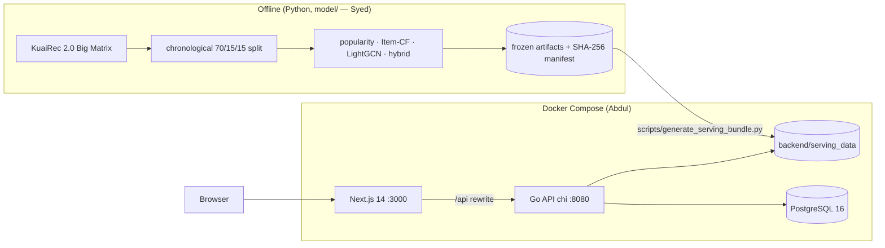

# Architecture



```text
Browser ─► Next.js (3000) ──/api, /healthz, /readyz, /metrics-api──► Go API (8080)
                                                                     ├─ loads serving_data/ at start (checksums + evidence verified)
                                                                     └─ PostgreSQL: feedback_events, recommendation_logs, api_requests
```

## Principles

1. **The API never trains or re-scores** (WBS §2.3). It filters and truncates frozen ranked lists produced offline.
2. **Every explanation is evidence.** Reasons are computed offline by Syed's `build_reasons` rule (`model/src/freeze_day9.py`) against the same history used to rank, and validated at start-up against `model/reason_codes.json`.
3. **No test-set influence.** Weights and model choice come from validation; the home feed serves the single controlled-test pass of the selected model; comparisons use validation-time lists for every model so they share one candidate protocol.
4. **Auditable.** The manifest records the dataset release, weights, reason rules, the SHA-256 of every frozen source artifact and of every bundle file. The API refuses to start on any mismatch.

## Serving bundle (`backend/serving_data`, ~19 MB)

| File | Content |
|---|---|
| `catalog.json` | 8,418 eligible items; official caption/category/topic tags + first `item_daily_features` row (author, upload date, type, duration); training positive-event count |
| `recommendations.json.gz` | 7,176 users × top-20 frozen controlled-test hybrid list with component scores and reason evidence |
| `comparisons.json` | validation-time top-20 lists of all 4 models for 100 stratified demo users |
| `popularity.json` | training-only popularity order (fallback) |
| `user_profiles.json` | per-user seen/positive counts; recent positives and seen IDs for demo users |
| `item_similarity.json` | top-50 Item-CF neighbours per item (`scripts/export_item_similarity.py`) |
| `model_manifest.json`, `metrics_summary.json` | registry, provenance, checksums; evaluation summary |

Regenerate (from the project root, needs `model/artifacts` and `data/`):

```powershell
python backend-frontend/scripts/export_item_similarity.py
python backend-frontend/scripts/generate_serving_bundle.py
```

Files are written with LF line endings and marked `-text` in `.gitattributes` so checksums hold on Windows checkouts.

## Backend packages

| Package | Responsibility |
|---|---|
| `cmd/api` | configuration, start-up, graceful shutdown |
| `internal/catalog` | immutable catalog index |
| `internal/recommender` | bundle loading/verification, user classification, fallback, per-request model, comparison, similarity |
| `internal/explanation` | approved reason codes, evidence validation, cold-start reason |
| `internal/httpapi` | chi routes, strict validation, CORS, per-IP rate limit, access log + request persistence |
| `internal/telemetry` | request IDs, response-time header, counters |
| `internal/database` | PostgreSQL schema and queries; `:memory:` adapter for unit tests |

## Frontend routes (WBS §8)

| Route | Content |
|---|---|
| `/` | demo-user selector + free-text ID, per-request model, cold-start toggle, exclude-seen, top-K, sort, refresh; cards with rank/metadata/score/breakdown/reasons/feedback; hybrid explanation panel; user evidence panel; state banners |
| `/videos/[videoId]` | official metadata, categories, Item-CF neighbours |
| `/compare` | 4 models, same user and candidate protocol |
| `/metrics` | split summary, validation table, NDCG chart, controlled test, cold-start/seen checks |
| `/system` | readiness, telemetry, dataset release, manifest, reason rules, checksums, reproducibility |

## Deployment

`docker compose up --build -d` starts PostgreSQL 16.6, the API (non-root, health-checked) and Next.js (standalone, non-root). The API waits for a healthy database; the web container waits for a healthy API. PostgreSQL data lives in the `postgres-data` volume, so feedback and logs survive container restarts (`docs/evidence/restart_verification.txt`).
