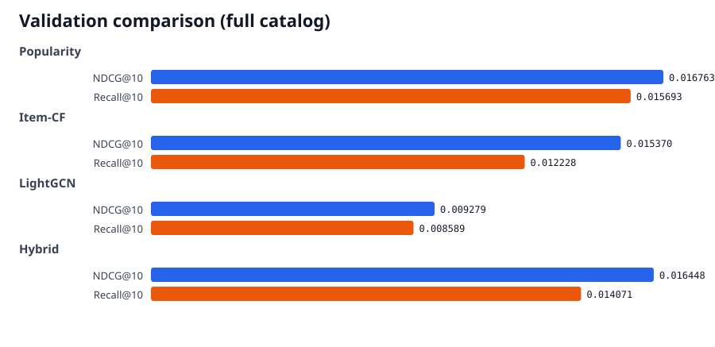
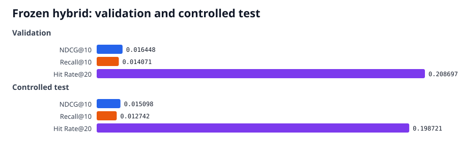

# Explainable KuaiRec Short-Video Recommender

## Abstract

This project builds a reproducible offline top-K recommender from the KuaiRec
2.0 Big Matrix. It compares training-only popularity, item-based collaborative
filtering (Item-CF), and LightGCN, then selects a constrained validation-tuned
hybrid. The selected model uses 0.1 popularity, 0.9 Item-CF, and 0.0 LightGCN.
One locked controlled-test pass achieved NDCG@10 0.015098, Recall@10 0.012742,
Hit Rate@20 0.198721, and catalog coverage@20 0.638513. Every saved result has
model-input evidence, but high miss rates and concentrated exposure prevent a
production-readiness claim.

## Dataset and methodology

KuaiRec is a real-world Kuaishou recommendation dataset. Its authors introduced
the nearly fully observed Small Matrix to study how density and exposure bias
affect offline evaluation [1]. This implementation instead uses the temporally
rich Big Matrix because the project requires chronological splitting; the Small
Matrix is audit-only and is not treated as an independent test set.

The verified KuaiRec 2.0 archive has SHA-256
`c23f211cf109c7a060a25a4afe9e8c681b1ccbbc816cca921d87ad37dd11c70c`.
After retaining the first repeated `(user_id, video_id, timestamp)` record and
applying an iterative distinct-edge training-only 5-core, the working data has
7,176 users, 8,418 items, and 11,299,325 events. Relevance is the predeclared
derived proxy `watch_ratio > 2.0`, not an explicit like or satisfaction label.

Each user is split chronologically 70/15/15 before catalog filtering. Training
eligibility and features never use validation or test events. Validation ranks
the eligible catalog minus training-seen items; test additionally removes
validation-seen items. Users with no eligible held-out positive are excluded
from ranking-metric means and reported separately. The seed is 2026, K=10 is
primary, and K=20 is secondary.

## Models and experimental setup

- **Popularity:** count of positive training events, also the cold-start
  fallback.
- **Item-CF:** binary-positive item cosine similarity, shrinkage 200, five
  neighbors, and `log1p(watch_ratio)` preference strength. Hyperparameters are
  selected on validation only.
- **LightGCN:** linear neighborhood propagation over the user-item graph, based
  on the architecture proposed by He et al. [2]. The permitted validation grid
  selected 32 dimensions, two layers, learning rate 0.002, and 15 epochs.
- **Hybrid:** per-user min-max normalized component scores. All 66 nonnegative
  weight triples on a 0.1 grid summing to one are evaluated using validation
  NDCG@10, then Recall@10, with simpler/less-LightGCN ties preferred.

Every model uses the same full-catalog candidate protocol and seen-item policy.
Selection manifests declare no test use, and the leakage audit reports no
chronology, split-hash, frozen-artifact, or selection-source violation.

## Results and ablations

| Model | Recall@10 | Recall@20 | NDCG@10 | NDCG@20 | Coverage@20 |
|---|---:|---:|---:|---:|---:|
| Popularity | 0.015693 | 0.024042 | 0.016763 | 0.019448 | 0.026372 |
| Item-CF | 0.012228 | 0.020438 | 0.015370 | 0.018089 | 0.661796 |
| LightGCN | 0.008589 | 0.015793 | 0.009279 | 0.012077 | 0.570801 |
| Hybrid | 0.014071 | 0.029101 | 0.016448 | 0.021916 | 0.622832 |

The hybrid improves every reported ranking metric over Item-CF, but popularity
remains slightly better on validation Recall@10 and NDCG@10. Thus the hybrid is
not claimed to dominate every baseline. The selected configuration is also the
best pair without LightGCN: no positive LightGCN weight improves the primary
objective. LightGCN is retained as an evaluated rejected experiment, contributes
no final score, and emits no explanation.

After freezing model identity, weights, artifacts, reason rules, and evaluator
protocol, the model was evaluated once on test data.

| Controlled-test measure | Result |
|---|---:|
| Metric-eligible / total users | 6,255 / 7,176 |
| Recall@10 / Recall@20 | 0.012742 / 0.025472 |
| NDCG@10 / NDCG@20 | 0.015098 / 0.019188 |
| Precision@10 / Precision@20 | 0.012902 / 0.013397 |
| Hit Rate@10 / Hit Rate@20 | 0.109033 / 0.198721 |
| Catalog coverage@20 | 0.638513 (5,375 items) |

All 143,520 predictions contain no duplicate or previously seen item. The four
users without positive pre-test history exactly match the frozen popularity
fallback after seen-item removal. Each recommendation has validated Item-CF
contribution and/or training-popularity evidence.

## Failure analysis and limitations

The dominant failure is ranking quality: 5,573 metric-eligible users (89.10%)
have no relevant top-10 result, and 5,012 (80.13%) have none in the top 20.
Another 921 users have no eligible relevant test candidate and remain separately
visible rather than silently entering metric means. Exposure is concentrated:
69.11% of slots come from the top popularity decile, while the most-exposed 1%
of items receive 48.81% of slots despite broad aggregate catalog coverage.

Three 200-resample user-level bootstrap runs (seeds 2026–2028) produce small
seed-specific Monte Carlo mean spreads. This measures sampling uncertainty of
the frozen test users; it is not independent retraining evidence. Demographic,
creator, category, temporal-drift, and content-safety fairness remain unmeasured.
Offline proxy metrics cannot establish satisfaction, causal benefit, safety, or
production readiness.

## Reproducibility and conclusion

Generated manifests bind the dataset release, split protocol, selected model,
artifact hashes, controlled-test output, explanations, charts, and claim audit.
The model-selection lock was not reopened after test results. The central result
is therefore intentionally modest: a simple popularity–Item-CF hybrid provides
the strongest supported validation tradeoff, while LightGCN adds no supported
value under this protocol. The system is suitable as a reproducible educational
offline demonstration, not a deployed personalization claim.

## References

1. Gao, C. et al. (2022). “KuaiRec: A Fully-observed Dataset and Insights for
   Evaluating Recommender Systems.” CIKM 2022.
   [DOI](https://doi.org/10.1145/3511808.3557220),
   [official repository](https://github.com/chongminggao/KuaiRec), and
   [verified release](https://zenodo.org/records/18164998).
2. He, X. et al. (2020). “LightGCN: Simplifying and Powering Graph Convolution
   Network for Recommendation.” SIGIR 2020.
   [arXiv](https://arxiv.org/abs/2002.02126).
